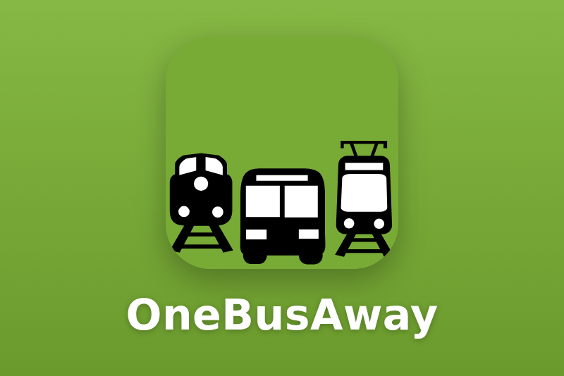

# OneBusAway for Gladys Assistant



Real-time arrivals of your OneBusAway stops in [Gladys Assistant](https://gladysassistant.com):
Puget Sound (Seattle: King County Metro, Sound Transit, Community Transit…), Tampa Bay, San Diego,
Washington D.C., Adelaide, Davis, or any other OneBusAway server.

> Developed without the transit network at hand, against the real Puget Sound API: feedback
> welcome.

## What it does

- **A device per watched stop**, optionally filtered by routes or direction: next and following
  departure (minutes), delay, route and destination, real-time prediction (yes/no), service alert
  in force (yes/no).
- **A dashboard widget** with the next eight departures of a stop, coloured by real time, delay
  and cancellation, with the service alerts of the agency.
- **Scene triggers**: time to leave (1 to 20 minutes before a departure), departure delayed (1 to
  60 minutes), new service alert.
- **A scene action** returning the next departures and a sentence ready to send ("67 to Northgate
  Station at Benton Ln: in 7 and 19 min").

## Requirements

- Gladys Assistant 5.3.0 or later, with internet access.
- An API key for your region (free; Puget Sound: `oba_api_key@soundtransit.org`). Empty, the
  public `TEST` key of Puget Sound is used: fine for a try, heavily rate-limited.

## Installation

In Gladys: **Integrations → Install from GitHub**, then paste
`https://github.com/guim31/gladys-onebusaway`. Choose the region, enter the key, find your stops
near a point with the configuration actions, add them, and create their devices in the **Discover**
tab. The full guide is in [docs/en.md](docs/en.md) ([fr](docs/fr.md), [de](docs/de.md),
[es](docs/es.md)).

## How it works

The integration calls the OneBusAway REST API (`/api/where/`) of the chosen server:
`arrivals-and-departures-for-stop` for each created device, every minute (or two), one stop after
the other, spaced by a second; `stop` and `stops-for-location` for the configuration actions. It
asks for the next two hours of each stop. The service alerts (`situations`) come in the same answer:
only the ones in force, on the stop or on the trips the device keeps, count. A refused request
(HTTP 429) is tried again twice.

## Limits

- No search by stop name: OneBusAway searches around a point.
- Service alerts are shown in the language of the agency.
- MTA New York (Bus Time) does not serve this API.
- Tested against the real Puget Sound server and its recorded answers only.

## Development

```bash
npm ci
npm run format:check && npm run lint && npm test
npx -y github:GladysAssistant/integration-store --skip-image-check .
```

The tests run against the SDK's fake Gladys and real OneBusAway answers recorded in
`test/fixtures/oba`; they never touch the network. See [`CLAUDE.md`](CLAUDE.md) for the project
rules.

## Credits

- [OneBusAway](https://onebusaway.org), by the Open Transit Software Foundation (Apache 2.0).
- Cover: the official OneBusAway app icon, from the
  [foundation's website](https://opentransitsoftwarefoundation.org/images/logos/onebusaway.svg).
- Data: the transit agencies of each region (King County Metro and Sound Transit for the test
  fixtures).
- Structure shared with the `gladys-sl-stockholm` integration.

Not affiliated with OneBusAway, the Open Transit Software Foundation or any transit agency.

## License

Apache-2.0
